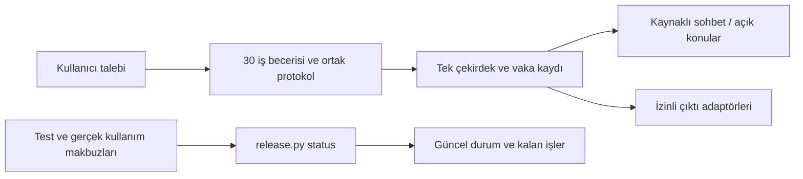

Ürün yolu `plugins/kilic-sozlesme-yonetimi/`, geliştirme/kabul aracı `tools/release.py`.
Teknik durum kanıttan yeniden üretilir; rapora elle PASS yazılmaz. Kişisel/kurumsal
kanıt dizini ürünün ve açık kaynak deposunun dışında tutulur; `status` ve `test`
çıktı kökü ürün, proje veya sahibi Git checkout içindeyse kapalı ret verir.



İlk beş kutu mevcut ürün mimarisidir. Son üçü yayın hazırlığıdır. Ürün durum
raporlarını okumadan çalışır; yayın aracı da şirket kaynaklarını, kullanıcı
cevaplarını, veritabanını veya çalışma yetkilerini değiştirmez. Güncelleyici
mevcut ayrı bileşendir. Yeni servis, veri tabanı, bağımlılık ve beceri eklenmez.

## Güncel durumu gör

Ürünün mevcut native Python ortamıyla, proje kökünden:

```powershell
python -B -X utf8 tools/release.py status --evidence <ozel-kanit-dizini>/evidence-index.json --output-root <ozel-cikti-dizini>
```

`status` test çalıştırmaz. Ürünün mevcut koşucusunun hash kurallarıyla dosyaları
ölçer; mevcut manifestten gerçek unittest keşfi yapar. Dinamik üretilen 30 beceri
testi de keşfe dahildir. Referans makbuzlarda FINAL/PASS, aynı kaynak/manifest,
değişmemiş dosyalar, sıfır hata/skip ve bütün etkin testlerin tam bir kez bulunması
gerekir. Makbuzdaki sınıf, seçilen test ve sonuç listeleri birbirine uymalıdır;
farklı Python/ABI/bağımlılık/Windows ortamlarının parçaları birleştirilmez.
Bir test eksikse veya iki makbuzda yineleniyorsa tam kapsam kabul edilmez.
Tarihsel kapsam dışı testler açıkça ayrı kalır.

Kanıt dizini JSON'u `schema: contract-release-evidence/v1`, `technical_receipts`
ve `observations` alanlarını taşır. Dosya yolları dizin dosyasına göredir; her
referans SHA-256 taşır. Gözlemler `id`, `title`, `scope`, `source_digest` ve
`artifacts` içerir. Artifact isteğe bağlı `checks` listesinde JSON pointer ile
tam değer eşliği denetleyebilir. Eksik/değişmiş belge INVALID_EVIDENCE, başka ürün
digest'ine bağlı gözlem STALE_SOURCE olur. RECORDED yalnız kaydın hash ve değer
denetimidir; kişi kimliği veya kurum yetkisi doğrulaması değildir. Hash ve JSON
değeri aynı okumadan alınır; rapor öncesinde kanıtların değişmediği yeniden
kontrol edilir. Her gözlemde en az bir artifact kontrolü `/source_digest`,
`/product_source_digest` veya `/candidate_source_digest` alanını gözlemin aday
kimliğine bağlamalıdır. Üstteki aday etiketini değiştirmek eski kanıtı güncel
yapmaz. Özel içerik
ürün paketine konulmaz.

Her çalıştırma yeni bir dizine `result.json` ve `DURUM.md` yazar. Eski makbuzlar
ve sonuçlar korunur. Komutun 0 çıkışı teknik kanıt/gözlem bütünlüğüdür; kararlı
yayın izni değildir. Genel `status`, kısa komut çıktısı ve Markdown raporu aynı
sonucu taşır: teknik test PASS olsa bile bir gözlem geçersiz/eskiyse veya kanıt
kontrol sırasında değişmişse genel sonuç BLOCKED'dır. Genel yayın kabulü otomatik
verilmez.

## Değişen ürünü sınama

Geliştirme sırasında mevcut `scripts/run_product_tests.py --suite ... --test ...`
girişiyle etkilenen testler çalışır. Son ürün adayı değiştiğinde tam koşu:

```powershell
python -B -X utf8 tools/release.py test --output-root <ozel-cikti-dizini> --shards 4 --workers 2
```

Tek manifestten dört çakışmasız grup üretilir. Bir test sınıfı parçalanmaz; gruplar
test sayısıyla dengelenir, süre garantisi verilmez. İki yerel Python süreci aynı
anda çalışır; bunlar model/ajan çağrısı değildir. Mevcut ürün koşucusu her grubu
kendi geçici staging alanında çalıştırır. Kaynak ve sonuç makbuzları değişmeden
korunur. Son birleşim tam kapsamı doğrular; tek grup PASS'ı tam kabul sayılmaz.
Bir grup hata verirse kanıtları korunur ve komut hata ile çıkar. `--shards 1`
tam kapsamı ürün koşucusunun kısa `--suite full` çağrısıyla yürütür; yüzlerce
test adını Windows komut satırına açmaz. Kısmi seçimler tam koşuya çevrilmez;
Windows komut uzunluğu sınırını aşan kısmi çağrı açıklamalı hata verir.

CI artık bu aynı komutu kullanır: tek bağımlılık kurulumu, dört ayrık grup, iki
eşzamanlı test süreci ve tek kapsam birleşimi. Önceki 16 örtüşen job kaldırıldı.
GitHub koşusu gerçekleşmeden CI PASS iddiası üretilmez. Yerel araç testleri:
`python -B -X utf8 tools/test_release.py`.

## Kararlı sürüme çalışma sırası

[remaining-work.json](remaining-work.json) kabul sonucu saklamayan iş sırasıdır.
Ürün/gerçek kaynak, uzman değerlendirmesi ve kurum/host işleri bağımsız ilerler;
son aday bunların gerçek sonuçlarını birleştirir. Mevcut ürünün eksik adaptörleri
ve tam iş senaryoları kapsamda kalır. Kullanıcı cevapları ve önceki dar kapsamlı
kabul tekrar sorulmaz. E-posta gönderiminin önceden kaldırılmış kapsamı korunur.

Ürün değişmemişse geçerli eski FINAL teknik makbuz yeniden kullanılır. Yayın
aracı, CI veya durum raporu değişikliği ürün digest'ini değiştirmez; bu araçların
kendi kontrolleri ayrıca yapılır. Dağıtım ZIP'i dış proje dosyalarını da içeriyorsa
ZIP hash'i ayrıca yenilenmelidir; aynı ürün digest'i eski ZIP ile bayt eşliği
iddiası değildir. Ürün koduna değişiklikler mümkün olduğunca tek adayda toplanır;
son ürün değişince kurulum/host ve ilgili iş kabulü yeniden değerlendirilir.
